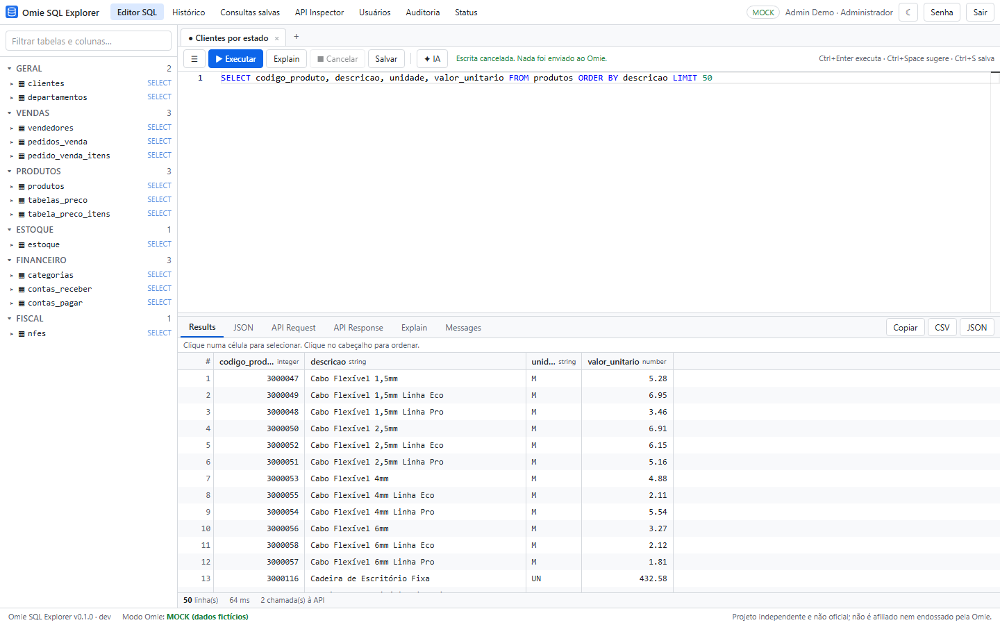
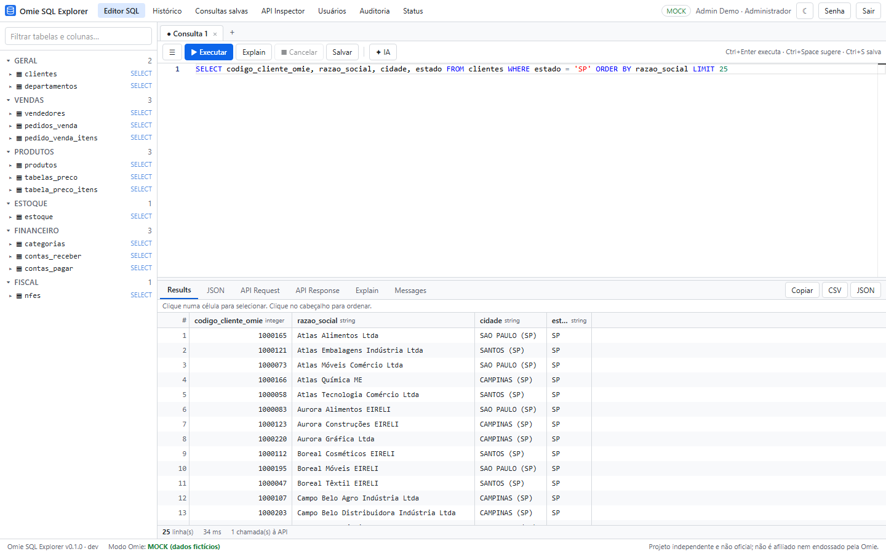
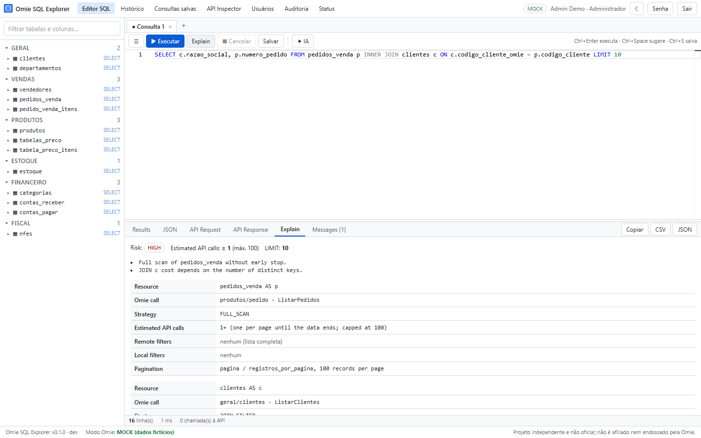
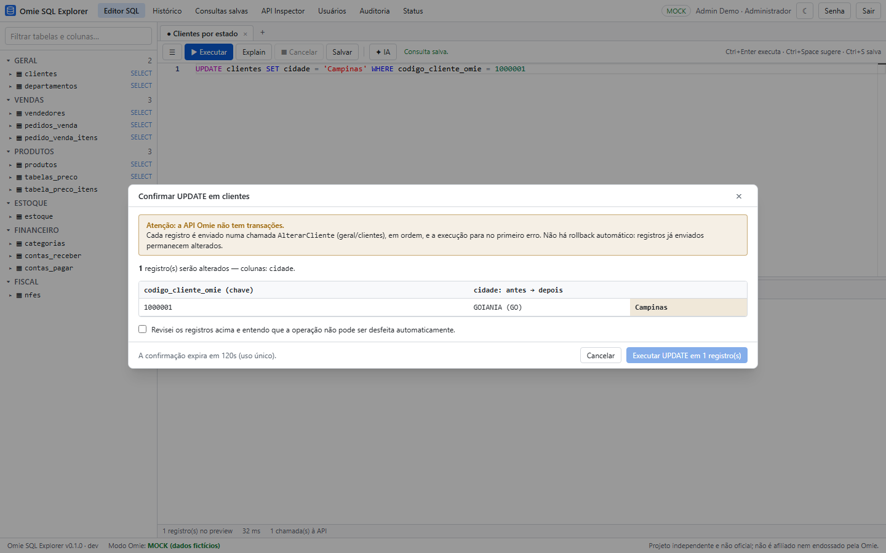
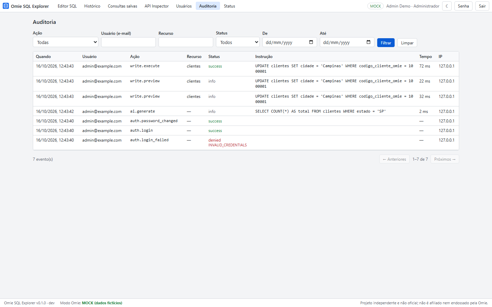
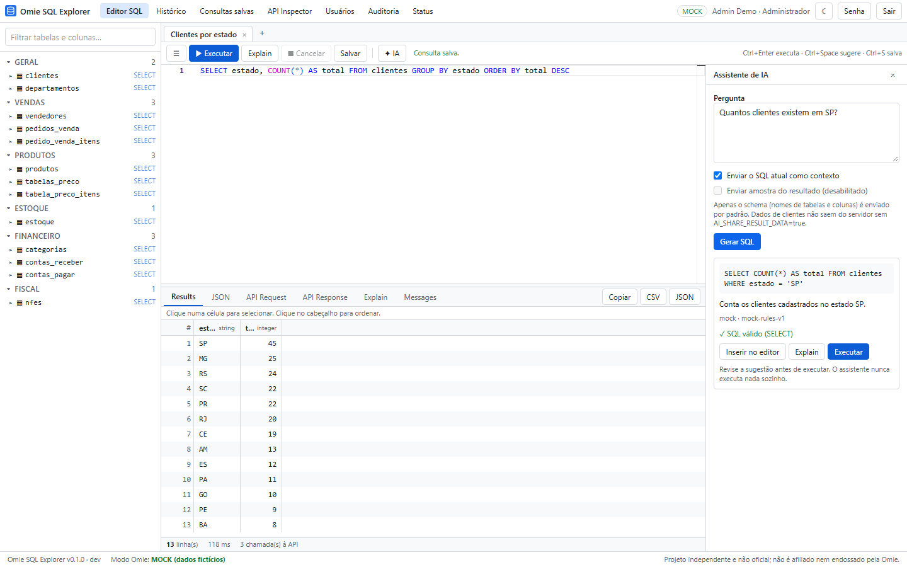
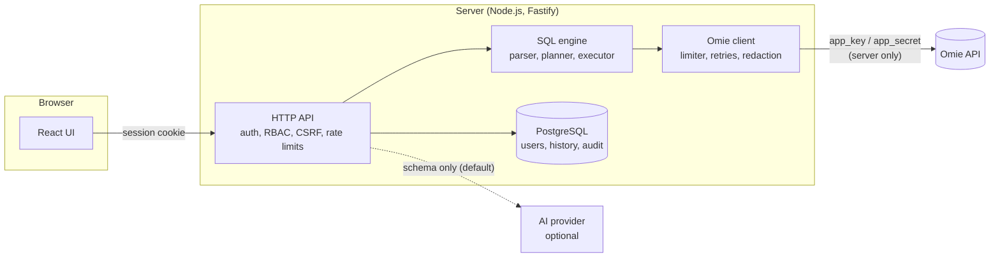

# Omie SQL Explorer

[](https://github.com/Gustavo-Ale07/dbexplorer-omie/actions/workflows/ci.yml)
[](https://github.com/Gustavo-Ale07/dbexplorer-omie/actions/workflows/codeql.yml)
[](LICENSE)

SQL-like explorer for the [Omie](https://www.omie.com.br/) ERP API with safe writes, query
planning, audit logs and AI-assisted querying.

**[Leia em português](README.pt-BR.md)**



Omie offers a REST API, not a database. This project adds a **virtual SQL layer** on top of it:
you write `SELECT … FROM clientes WHERE estado = 'SP'` and the server turns it into the right
Omie calls, pushes filters to the API where it can, paginates, joins and aggregates, and shows you
exactly which calls it made. Writes (`INSERT`, `UPDATE`, `DELETE`) are disabled by default. When
they are enabled, every write is previewed and has to be confirmed explicitly.

It never touches Omie's own database: every read and write goes through the official public
Omie API, so what you can do is bounded by what that API offers. The bundled PostgreSQL is only the
application's internal store (users, sessions, query history, saved queries and the audit log);
Omie data is never copied into it. This is an independent project, not an official Omie product.

> This is not a database. There are no transactions, no DDL and no rollback. See
> [Limitations](#limitations).

## Features

- **SQL editor**: Monaco, with autocompletion from the schema, run-at-cursor (`Ctrl+Enter`) and
  multiple tabs.
- **A virtual schema** of 13 Omie resources (customers, products, price tables, stock,
  salespeople, sales orders and their items, categories, receivables, payables, NF-e, …), driven
  by a declarative [resource registry](docs/omie-resources.md).
- **The dialect**: `SELECT` with `WHERE`, `IN`, `BETWEEN`, `LIKE`, `IS NULL`, `INNER`/`LEFT JOIN`,
  `GROUP BY`, `HAVING`, aggregates, `ORDER BY`, `LIMIT/OFFSET`, plus `SHOW TABLES`, `DESCRIBE` and
  `EXPLAIN`. See the [SQL dialect](docs/sql-dialect.md).
- **A query planner** that picks a strategy per table (primary-key lookup, API filter, full scan,
  metadata count), estimates API calls, flags risk and enforces limits on rows, API calls and
  time.
- **Safe writes**: off by default, a flag per operation, role-based permissions, `WHERE` required,
  a cap on target rows, a before/after preview, a single-use confirmation token bound to user,
  session and statement, revalidation before execution, no automatic retries, and an audit trail.
- **API Inspector**: calls any allowlisted Omie method with a JSON body and shows the redacted
  request and the response. URLs cannot be typed in.
- **Results**: a virtualized grid, JSON view, the plan, the API calls made (credentials redacted)
  and CSV/JSON export.
- **History, saved queries, users with roles (`VIEWER`, `OPERATOR`, `ADMIN`) and an audit log.**
- **AI assistant (optional)**: turns a question into SQL using the schema (OpenAI, Anthropic or a
  local mock). It never runs anything, and result data is only shared if you opt in.
- **Mock mode**: a deterministic fake Omie with fictitious data, so you can try everything without
  an Omie account.

|                                                      |                                                    |
| ---------------------------------------------------- | -------------------------------------------------- |
|  |  |
|  |        |



## How it works



The browser never talks to Omie, and the Omie credentials never leave the server. More in
[Architecture](docs/architecture.md).

```sql
EXPLAIN
SELECT p.numero_pedido, c.razao_social, p.valor_total_pedido
FROM pedidos_venda p
INNER JOIN clientes c ON c.codigo_cliente_omie = p.codigo_cliente
WHERE p.etapa = '50'
ORDER BY p.valor_total_pedido DESC
LIMIT 20;
```

## Quick start

Requirements: Docker with the Compose plugin.

```bash
git clone https://github.com/Gustavo-Ale07/dbexplorer-omie.git
cd dbexplorer-omie
cp .env.example .env
nano .env
docker compose up -d --build
```

In `.env`, set at least `APP_URL`, `POSTGRES_PASSWORD`, `SESSION_SECRET`,
`BOOTSTRAP_ADMIN_EMAIL` and `BOOTSTRAP_ADMIN_PASSWORD`. The app **refuses to start** in production
while any of them still holds a placeholder or a weak value. It starts in mock mode
(`OMIE_MODE=mock`); set `OMIE_MODE=live` with `OMIE_APP_KEY` and `OMIE_APP_SECRET` to use a real
account.

The app listens on `127.0.0.1:3001`. Put it behind a reverse proxy with HTTPS. Then sign in with
the bootstrap administrator, who must change the password on first login.

The full guide covers HTTPS, the reverse proxy, backups and upgrades:
[Deployment](docs/deployment.md).

## Development

```bash
pnpm install
pnpm dev          # API on :3001, web on :5173 (mock Omie, in-memory PostgreSQL)
pnpm test:unit
pnpm test:integration
pnpm test:e2e     # after pnpm build
```

No Omie account or database server is needed. See [Development](docs/development.md).

## Tech stack

TypeScript everywhere. Fastify 5, Node.js 24, PostgreSQL 17 with Drizzle ORM (PGlite in
development and tests), React 19, Vite, Tailwind CSS, Monaco, TanStack Query/Virtual,
node-sql-parser, Vitest and Playwright. The decisions are recorded as [ADRs](docs/adr/README.md).

## Security

- Omie credentials stay on the server and are redacted from every response, log, history entry
  and audit record.
- Argon2id passwords, hashed session tokens, `__Host-` cookies (`Secure`, `HttpOnly`,
  `SameSite=Strict`), account lockout, rate limits, CSRF origin checks, strict CSP and security
  headers.
- The config is validated at boot, and production refuses weak secrets.
- Omie calls go only to allowlisted methods. There is no user-supplied URL anywhere.
- CI runs lint, type checks, tests, CodeQL, dependency review, a secret scan and a Docker smoke
  test.

Read the [threat model](docs/security.md). To report a vulnerability, see
[SECURITY.md](SECURITY.md).

## Limitations

- **No transactions.** `BEGIN`/`COMMIT`/`ROLLBACK` are rejected. A multi-record write runs one
  call per record and stops at the first failure, so it can end partially applied. The outcome
  shows exactly which records changed.
- **No DDL.** The schema is fixed by the registry.
- **A subset of SQL.** There are no subqueries, CTEs, `UNION`, window functions, `CASE` or
  `RIGHT`/`FULL` joins.
- **Cost is API calls.** Filters that Omie cannot apply run locally after a scan. Large scans are
  bounded by `OMIE_MAX_API_CALLS` and `OMIE_MAX_ROWS`, and Omie's own rate limits apply.
- **Unconfirmed payloads.** Some write payloads could not be verified against a live account and
  are marked UNCONFIRMED in the [resource docs](docs/omie-resources.md). Test them on a test
  company first.
- **Single instance.** Rate limits, the Omie call limiter and query cancellation are kept in
  memory, so they assume one app instance.

Problems? See [Troubleshooting](docs/troubleshooting.md).

## Roadmap

- More Omie resources (services, purchase orders, bank accounts, CRM).
- Saved query parameters and scheduled exports.
- Shared rate limiting for multi-instance deployments.
- OpenID Connect sign-in.
- Column-level permissions.

## License

[MIT](LICENSE)

This is an independent project. It is not affiliated with or endorsed by Omie.
