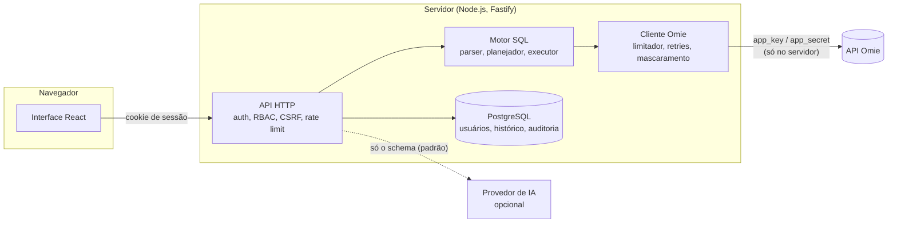

# Omie SQL Explorer

[](https://github.com/Gustavo-Ale07/dbexplorer-omie/actions/workflows/ci.yml)
[](https://github.com/Gustavo-Ale07/dbexplorer-omie/actions/workflows/codeql.yml)
[](LICENSE)

Explorador com sintaxe SQL para a API do ERP [Omie](https://www.omie.com.br/), com escrita
segura, planejamento de consultas, log de auditoria e assistente de IA.

**[Read in English](README.md)**


O Omie oferece uma API REST, não um banco de dados. Este projeto cria uma **camada SQL virtual**
por cima dela: você escreve `SELECT … FROM clientes WHERE estado = 'SP'` e o servidor transforma
isso nas chamadas certas do Omie. Ele envia os filtros para a API quando ela os suporta, pagina,
faz joins e agregações, e mostra exatamente quais chamadas foram feitas. A escrita (`INSERT`,
`UPDATE`, `DELETE`) vem desativada. Quando está ativada, toda escrita mostra uma prévia e exige
confirmação explícita.

> Isto não é um banco de dados. Não há transações, DDL nem rollback. Veja
> [Limitações](#limitações).

## Funcionalidades

- **Editor SQL**: Monaco, com autocompletar a partir do schema, execução da instrução sob o
  cursor (`Ctrl+Enter`) e várias abas.
- **Schema virtual** com 13 recursos do Omie (clientes, produtos, tabelas de preço, estoque,
  vendedores, pedidos de venda e itens, categorias, contas a receber, contas a pagar, NF-e, …),
  definido por um [registro de recursos](docs/omie-resources.md) declarativo.
- **Dialeto**: `SELECT` com `WHERE`, `IN`, `BETWEEN`, `LIKE`, `IS NULL`, `INNER`/`LEFT JOIN`,
  `GROUP BY`, `HAVING`, agregações, `ORDER BY` e `LIMIT/OFFSET`, além de `SHOW TABLES`,
  `DESCRIBE` e `EXPLAIN`. Veja o [dialeto SQL](docs/sql-dialect.md).
- **Planejador de consultas**: escolhe a estratégia de cada tabela (busca por chave, filtro na
  API, varredura completa, contagem por metadados), estima as chamadas à API, sinaliza o risco e
  impõe limites de linhas, de chamadas e de tempo.
- **Escrita segura**:
  - desativada por padrão, com uma flag por operação e permissões por papel;
  - `WHERE` obrigatório e um teto de registros afetados;
  - prévia antes/depois e token de confirmação de uso único, vinculado ao usuário, à sessão e à
    instrução;
  - revalidação antes de executar, sem retry automático e com trilha de auditoria.
- **API Inspector**: chama qualquer método do Omie que esteja na allowlist, com corpo JSON, e
  mostra a requisição (com as credenciais mascaradas) e a resposta. Não é possível digitar URLs.
- **Resultados**: grade virtualizada, visão JSON, o plano, as chamadas feitas (credenciais
  mascaradas) e exportação em CSV/JSON.
- **Histórico, consultas salvas, usuários com papéis (`VIEWER`, `OPERATOR`, `ADMIN`) e log de
  auditoria.**
- **Assistente de IA (opcional)**: transforma uma pergunta em SQL usando o schema (OpenAI,
  Anthropic ou um mock local). Ele nunca executa nada, e os dados de resultado só são enviados se
  você permitir.
- **Modo mock**: um Omie falso e determinístico, com dados fictícios, para testar tudo sem conta
  no Omie.

|                                                          |                                              |
| -------------------------------------------------------- | -------------------------------------------- |
|         |   |
|  |  |


## Como funciona



O navegador nunca fala com o Omie, e as credenciais do Omie nunca saem do servidor. Mais detalhes
em [Arquitetura](docs/architecture.md) (em inglês).

```sql
EXPLAIN
SELECT p.numero_pedido, c.razao_social, p.valor_total_pedido
FROM pedidos_venda p
INNER JOIN clientes c ON c.codigo_cliente_omie = p.codigo_cliente
WHERE p.etapa = '50'
ORDER BY p.valor_total_pedido DESC
LIMIT 20;
```

## Início rápido

Requisitos: Docker com o plugin Compose.

```bash
git clone https://github.com/Gustavo-Ale07/dbexplorer-omie.git
cd dbexplorer-omie
cp .env.example .env
nano .env
docker compose up -d --build
```

No `.env`, defina pelo menos `APP_URL`, `POSTGRES_PASSWORD`, `SESSION_SECRET`,
`BOOTSTRAP_ADMIN_EMAIL` e `BOOTSTRAP_ADMIN_PASSWORD`. Em produção, a aplicação **não inicia**
enquanto algum deles tiver valor de exemplo ou fraco. Ela começa em modo mock (`OMIE_MODE=mock`).
Para usar uma conta real, defina `OMIE_MODE=live` com `OMIE_APP_KEY` e `OMIE_APP_SECRET`.

A aplicação escuta em `127.0.0.1:3001`. Coloque-a atrás de um proxy reverso com HTTPS. Depois,
entre com o administrador inicial, que precisa trocar a senha no primeiro acesso.

O guia completo cobre HTTPS, proxy reverso, backup e atualização:
[Deployment](docs/deployment.md) (em inglês).

## Desenvolvimento

```bash
pnpm install
pnpm dev          # API em :3001, web em :5173 (Omie mock, PostgreSQL em memória)
pnpm test:unit
pnpm test:integration
pnpm test:e2e     # depois de pnpm build
```

Não é preciso conta no Omie nem servidor de banco. Veja [Development](docs/development.md).

## Stack

TypeScript em tudo. Fastify 5, Node.js 24, PostgreSQL 17 com Drizzle ORM (PGlite em
desenvolvimento e nos testes), React 19, Vite, Tailwind CSS, Monaco, TanStack Query/Virtual,
node-sql-parser, Vitest e Playwright. As decisões estão registradas em [ADRs](docs/adr/README.md).

## Segurança

- As credenciais do Omie ficam no servidor e são mascaradas em toda resposta, log, histórico e
  registro de auditoria.
- Senhas com Argon2id, tokens de sessão armazenados como hash, cookies `__Host-` (`Secure`,
  `HttpOnly`, `SameSite=Strict`), bloqueio de conta, rate limit, verificação de origem contra
  CSRF, CSP restritiva e headers de segurança.
- A configuração é validada no boot, e a produção recusa segredos fracos.
- As chamadas ao Omie só vão para métodos da allowlist. Em nenhum lugar o usuário informa URL.
- O CI roda lint, checagem de tipos, testes, CodeQL, dependency review, varredura de segredos e
  smoke test do Docker.

Leia o [modelo de ameaças](docs/security.md). Para reportar uma vulnerabilidade, veja o
[SECURITY.md](SECURITY.md).

## Limitações

- **Sem transações.** `BEGIN`/`COMMIT`/`ROLLBACK` são recusados. Uma escrita com vários registros
  faz uma chamada por registro e para na primeira falha, então pode ficar aplicada pela metade. O
  resultado mostra exatamente quais registros mudaram.
- **Sem DDL.** O schema é definido pelo registro de recursos.
- **Subconjunto de SQL.** Não há subqueries, CTEs, `UNION`, window functions, `CASE` nem joins
  `RIGHT`/`FULL`.
- **O custo é medido em chamadas à API.** Filtros que o Omie não aplica rodam localmente, depois de
  uma varredura. Varreduras grandes são limitadas por `OMIE_MAX_API_CALLS` e `OMIE_MAX_ROWS`, e os
  limites de taxa do próprio Omie continuam valendo.
- **Payloads não confirmados.** Alguns payloads de escrita não puderam ser verificados numa conta
  real e estão marcados como UNCONFIRMED na [documentação dos recursos](docs/omie-resources.md).
  Teste-os primeiro numa empresa de testes.
- **Instância única.** O rate limit, o limitador de chamadas ao Omie e o cancelamento de consultas
  ficam em memória, então pressupõem uma única instância.

Problemas? Veja [Troubleshooting](docs/troubleshooting.md).

## Roadmap

- Mais recursos do Omie (serviços, pedidos de compra, contas correntes, CRM).
- Parâmetros em consultas salvas e exportações agendadas.
- Rate limit compartilhado para várias instâncias.
- Login com OpenID Connect.
- Permissões por coluna.

## Licença

[MIT](LICENSE)

Projeto independente, sem afiliação com o Omie e sem endosso dele.
