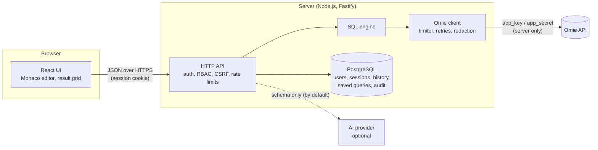
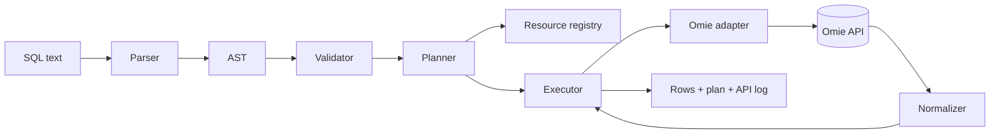

# Architecture

Omie SQL Explorer is a **virtual SQL layer** over the Omie ERP REST API. Omie has no SQL
endpoint and no database access: every statement is translated into a bounded sequence of Omie
API calls (`ListarClientes`, `ConsultarPedido`, `AlterarCliente`, …), and the JSON responses are
normalized into rows. There are no tables on our side; the **resource registry** defines them.



The browser never talks to Omie. `OMIE_APP_KEY` and `OMIE_APP_SECRET` exist only in the server
process; they are attached to each request by the Omie client and redacted from every log,
inspector entry, history row and audit record.

## Query pipeline



| Stage       | Module                              | Responsibility                                                                                                                                                                                                                   |
| ----------- | ----------------------------------- | -------------------------------------------------------------------------------------------------------------------------------------------------------------------------------------------------------------------------------- |
| Tokenizer   | `packages/sql-engine/src/tokenizer` | Classifies the statement (SHOW/DESCRIBE/EXPLAIN/transactions/DDL) before full parsing; strips `--` comments.                                                                                                                     |
| Parser      | `packages/sql-engine/src/parser`    | Uses `node-sql-parser` and converts its output into our own small AST. Anything outside the dialect fails with `SQL_UNSUPPORTED` — never silently ignored.                                                                       |
| Validator   | `packages/sql-engine/src/context`   | Resolves tables and aliases against the registry, checks columns, ambiguity, JOIN keys and aggregate usage.                                                                                                                      |
| Planner     | `packages/sql-engine/src/planner`   | Chooses a strategy per table (`PK_LOOKUP`, `API_FILTER`, `FULL_SCAN`, `METADATA_COUNT`; joins: `JOIN_LOOKUP`, `JOIN_FILTER`, `JOIN_SCAN`), splits WHERE into remote (pushed to Omie) and local filters, and estimates API calls. |
| Registry    | `packages/sql-engine/src/registry`  | Allowlist of endpoints and calls, column ↔ JSON path mapping, pushdown rules, write operations. The only place that knows Omie payload shapes.                                                                                   |
| Executor    | `packages/sql-engine/src/executor`  | Pages through Omie, applies local filters, joins, grouping, ordering, DISTINCT and LIMIT/OFFSET; enforces row, call and time limits.                                                                                             |
| Omie client | `packages/omie-client`              | HTTP transport, concurrency limiter (≤ 4 parallel calls), error classification, jittered retries for **reads only**, redaction. A mock transport serves demo data.                                                               |
| Writes      | `packages/sql-engine/src/writes`    | Plans INSERT/UPDATE/DELETE into per-record calls, computes statement and target hashes, executes sequentially and reports per-record outcomes.                                                                                   |
| API         | `apps/api`                          | Fastify server: sessions, RBAC, CSRF, confirmation tokens, history, saved queries, audit, AI assistant, static web UI.                                                                                                           |
| Web         | `apps/web`                          | React 19 + Vite UI: schema tree, tabs, Monaco with completion, virtualized grid, EXPLAIN view, API inspector, admin pages.                                                                                                       |
| Database    | `packages/database`                 | Drizzle schema and versioned SQL migrations for PostgreSQL (PGlite in memory for development and tests).                                                                                                                         |

## Strategies

The first table of a SELECT gets one access path:

| Strategy         | When                                                                                      | Omie calls                                  |
| ---------------- | ----------------------------------------------------------------------------------------- | ------------------------------------------- |
| `PK_LOOKUP`      | WHERE pins the key with `=` / `IN` and the resource has a `Consultar*` call               | one per key                                 |
| `API_FILTER`     | some predicates map to Omie list filters (e.g. `estado = 'SP'` → `clientesFiltro.estado`) | paged list, one partition per `IN` value    |
| `FULL_SCAN`      | nothing can be pushed down                                                                | paged list                                  |
| `METADATA_COUNT` | `SELECT COUNT(*) FROM t` with no WHERE                                                    | one page; total read from response metadata |

Joined tables use `JOIN_LOOKUP` (key is the inner table's lookup key), `JOIN_FILTER` (key maps to
an Omie list filter) or `JOIN_SCAN` (the inner table is scanned and hash-joined in memory).
Every predicate is re-applied locally even when it was pushed to Omie, so a loose remote filter
can never produce wrong rows. Paging stops early when the requested window
(`OFFSET + LIMIT`) is known to be complete — that is, when no local filter, ordering, grouping or
DISTINCT needs the full set.

## Limits

Every query runs under explicit limits; exceeding one fails with a named error instead of
returning partial data:

| Limit                                     | Error                      |
| ----------------------------------------- | -------------------------- |
| `LIMIT` above `OMIE_MAX_ROWS`             | `QUERY_ROW_LIMIT_EXCEEDED` |
| more Omie calls than `OMIE_MAX_API_CALLS` | `API_CALL_LIMIT_EXCEEDED`  |
| too many rows held in memory              | `QUERY_LIMIT_EXCEEDED`     |
| JOIN fan-out above the cap                | `JOIN_CARDINALITY_LIMIT`   |
| wall-clock above `OMIE_QUERY_TIMEOUT_MS`  | `QUERY_TIMEOUT`            |

A SELECT without `LIMIT` gets an implicit `LIMIT OMIE_MAX_ROWS`. When more rows exist the result
says `truncated: true` and the UI shows a message; it is never cut silently.

Two limits protect the shared Omie quota rather than a single query:

- `OMIE_MAX_CALLS_PER_MINUTE` (default 240) is a token bucket shared by the whole process. Calls
  over the budget wait their turn (still bounded by the query timeout) instead of reaching Omie,
  which temporarily blocks keys that exceed its own limits.
- Each user can have at most 3 queries running at once (`RATE_LIMITED` beyond that).

## Writes

```mermaid
sequenceDiagram
  actor U as User
  participant W as Web UI
  participant S as Server
  participant O as Omie API
  U->>W: UPDATE clientes SET ... WHERE ...
  W->>S: POST /api/query
  S->>S: flags + RBAC + WHERE required
  S->>O: read matching records (SELECT)
  S-->>W: preview: targets, before/after, risk, single-use token
  U->>W: tick acknowledgement, confirm
  W->>S: POST /api/query/confirm (token)
  S->>S: verify HMAC, TTL, user, session, statement hash; consume token
  S->>O: re-read targets, compare targets hash
  S->>O: one call per record, in order, no retry
  S->>S: audit (before/after, outcome per record)
  S-->>W: outcome (success / partial / failed)
```

Omie has no transactions. Each record is a separate call; the run stops at the first failure and
the report lists which records were changed, which failed and which were never sent. Nothing is
"rolled back" automatically, and the UI says so before confirmation.

## Persistence

PostgreSQL stores only application data: users (Argon2id hashes), sessions (hashed tokens),
query history, saved queries, write previews (single-use confirmation rows) and the audit log.
No Omie data is cached in the database. Migrations are generated by drizzle-kit, versioned in
`packages/database/migrations` and applied on boot.

## Deployment shape

A single container serves the API and the built web UI on one origin (no CORS), behind a reverse
proxy that terminates TLS. PostgreSQL runs on an internal Docker network with no published port.
See [deployment.md](deployment.md).
